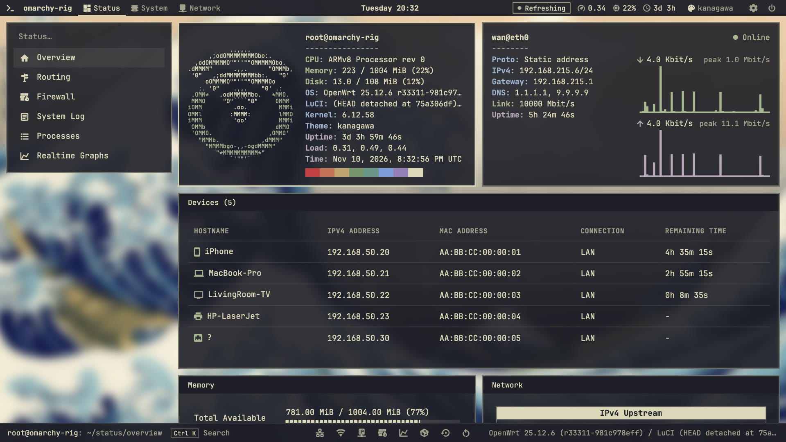
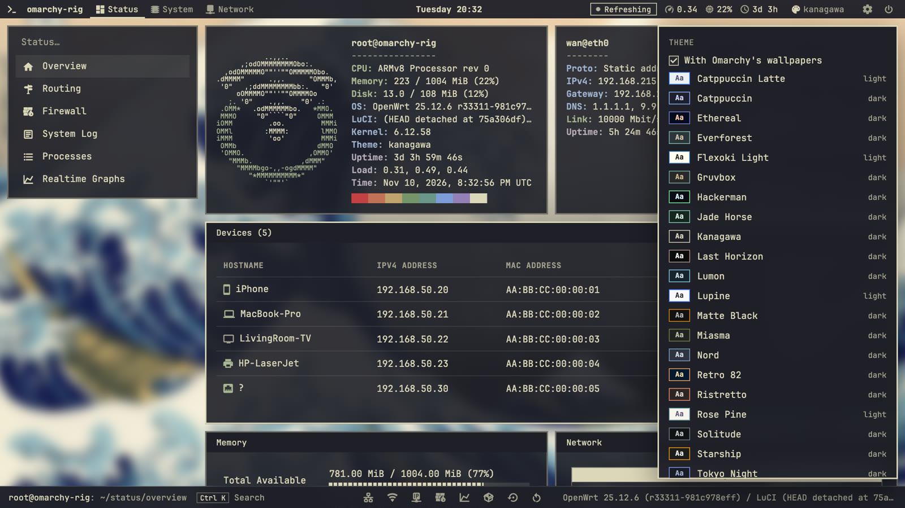
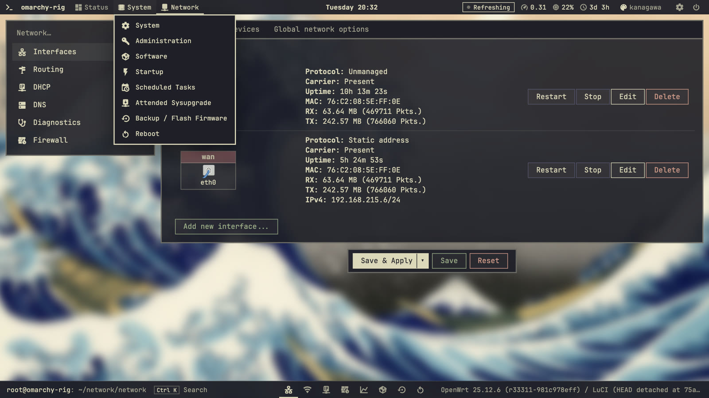
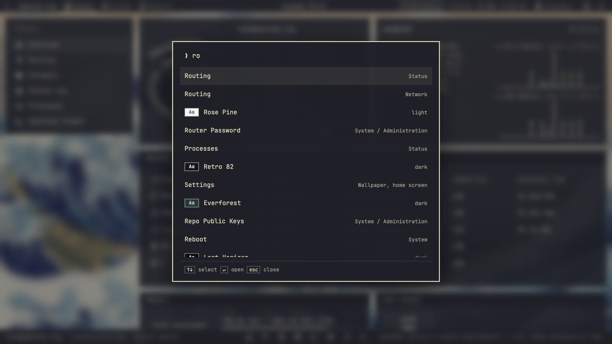
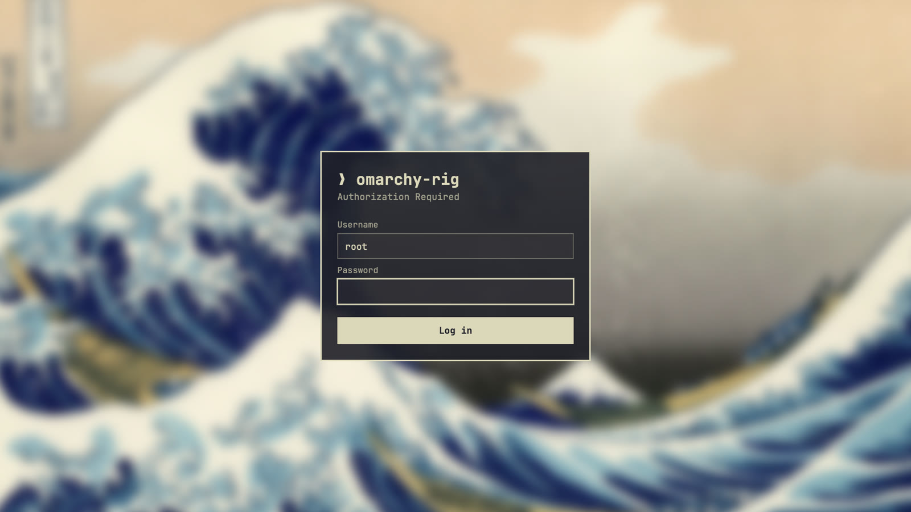
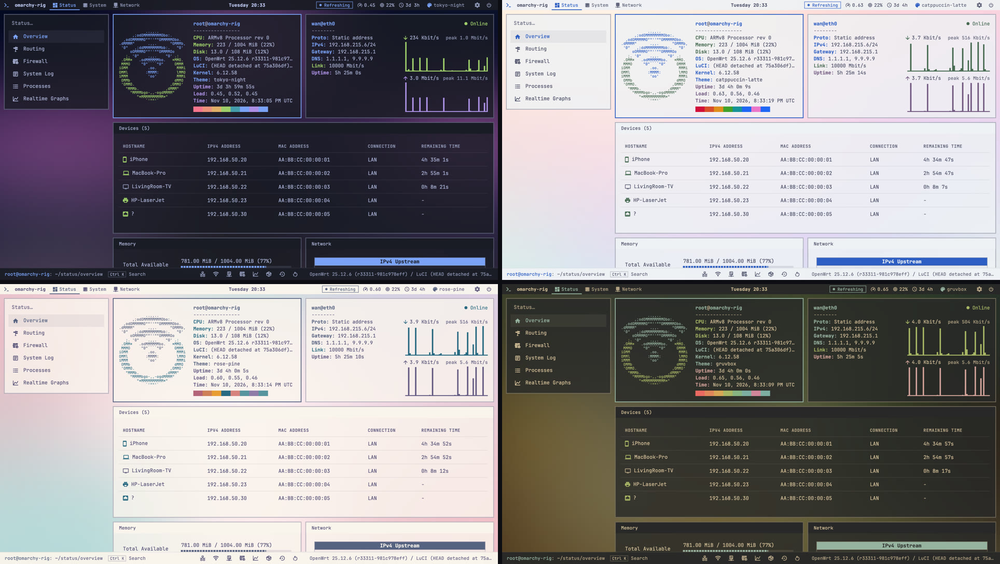

# luci-theme-omarchy

A theme for LuCI, the OpenWrt web interface, that draws the router as an
[Omarchy](https://github.com/omacom/omarchy) desktop: a bar with workspaces
across the top, glass windows over the blurred wallpaper of the theme, monospace
type, a keyboard launcher, and the Omarchy colour palettes.



This is an unofficial project. It is not affiliated with or endorsed by Omarchy
or by OpenWrt.

## What it does

- **Bar.** The top level of the menu becomes workspaces in a bar, each with its
  icon, with the router's clock in the middle and load, memory use and uptime on
  the right.
  The pages of the current workspace are listed in a side panel, deeper levels
  are tabs. The bar and the status line at the bottom stay on screen while the
  page scrolls between them, and the page does not stretch at its ends.
- **Home.** The status overview is the home screen: the router printed the way
  fastfetch prints a machine, one short line per fact beside the OpenWrt logo that
  fastfetch has. Next to it an Internet window shows the state of the WAN
  connection and its current and peak speed, and below them a Devices window lists
  what is connected right now, with its address and MAC. The other widgets follow
  in as many columns as fit. Widgets that other packages add to the overview
  appear there as well.
- **Changing page.** LuCI draws each page by script. The picture of the old page
  stays on screen until the new one is complete, and nothing moves while it is
  drawn. Browsers without cross-document view transitions, Firefox for now, see
  the pieces arrive in place.
- **Dock.** The status line at the bottom of every page holds the places a
  router's owner goes to most.
- **Windows.** Every widget is a window floating over the backdrop, with a solid
  title bar, a 2px border and 10px gaps, the values Omarchy gives Hyprland. The
  window the pointer or the keyboard went to last takes the accent colour.
- **Icons.** The side panel, the bar and the dock use the icon set of Omarchy's
  menu.
- **Backdrop.** Every palette has its own blurred desktop, made from the colours
  of a wallpaper that Omarchy has for that theme. It changes with the palette,
  also while you try palettes on.
- **Themes.** The name of the theme in the bar opens a list of all of Omarchy's
  themes. Pointing at one tries it on, clicking keeps it and closes the list.
  The tick box *With Omarchy's wallpapers* at the top of the list makes both
  happen with the real wallpaper of the theme.
- **Settings.** The cog in the bar opens a panel for the wallpaper, the widgets
  of the home screen and the dock.
- **Launcher.** `Ctrl+K` (`Cmd+K` on a Mac) or `/` opens a search over every
  page of the menu, the palettes and the settings.
- **Palettes.** The 23 colour schemes that Omarchy ships, each checked for
  contrast when the stylesheet is generated.
- **Login.** Built like the Omarchy lock screen: the blurred backdrop and one box.

| The list of themes, with Omarchy's wallpapers | A menu of the bar |
| --- | --- |
|  |  |

| The launcher: pages, palettes and settings | The login screen |
| --- | --- |
|  |  |

The package contains no wallpaper images and no Omarchy logo. A backdrop is 40
colours per palette, which is why it fits on a small router. The only font
shipped is a few KiB of icons. For text, the font stack names the monospace fonts
an Omarchy machine has and falls back to the monospace font of the system.

## Requirements

- OpenWrt 25.12 (LuCI branch `openwrt-25.12`). The theme was written against
  that release and has not been tried on older ones.
- A browser from 2024 or later. The stylesheet uses `:has()` and `backdrop-filter`.

## Building and installing

The package is built out of tree against the LuCI feed.

1. Put this directory into the buildroot as `package/luci-theme-omarchy`, for
   example with
   `git clone https://github.com/meerzulee/luci-theme-omarchy package/luci-theme-omarchy`.
   Copy it only with a tool that keeps symbolic links (`cp -a`, `rsync -a`). The
   palette aliases are links; copied as files they would multiply the size of
   the package by the number of palettes.
2. Make sure the LuCI feed is installed (`./scripts/feeds update luci` and
   `./scripts/feeds install -a -p luci`). The Makefile includes
   `feeds/luci/luci.mk`.
3. Select *LuCI → Themes → luci-theme-omarchy* in `make menuconfig`, or build
   the package alone with `make package/luci-theme-omarchy/compile`.
4. To add it to a running router, copy the `.apk` over and run
   `apk add --allow-untrusted luci-theme-omarchy-*.apk`.

Installing the package registers the theme and leaves the current design alone.
Switch to it under *System → System → Language and Style → Design*, or from a
shell:

```sh
uci set luci.main.mediaurlbase=/luci-static/omarchy
uci commit luci
```

To go back, choose *Bootstrap* in the same place, or:

```sh
uci set luci.main.mediaurlbase=/luci-static/bootstrap
uci commit luci
```

If a theme cannot be rendered at all, LuCI falls back to another installed
theme by itself, so a broken theme does not lock you out of the web interface.
Removing the package puts the design back to Bootstrap when Omarchy was in use.

To make the theme the default of a firmware image, add the two `uci` lines above
to a script in `files/etc/uci-defaults/` of the image. Give it a name that sorts
after `30_luci-theme-omarchy`, for example `99_theme`.

## Palettes

There are two ways to choose a palette.

- **For the router.** The *Design* list has one entry per palette: `Omarchy`
  is Tokyo Night, the others are named after their palette (`OmarchyNord`,
  `OmarchyGruvbox` and so on). This is what everyone sees, the login screen
  included. The matching `mediaurlbase` is `/luci-static/omarchy-<palette>`.
- **For one browser.** Click the name of the theme in the bar and pick one, or
  open the launcher and type its name. In the launcher the arrow keys try each
  palette on, `Enter` keeps it, `Esc` puts the previous one back. The choice is stored in that
  browser only. It belongs to the palette the router serves, so it is dropped
  when the router-wide design changes.

Palettes: Catppuccin, Catppuccin Latte, Ethereal, Everforest, Flexoki Light,
Gruvbox, Hackerman, Jade Horse, Kanagawa, Last Horizon, Lumon, Lupine, Matte
Black, Miasma, Nord, Retro 82, Ristretto, Rose Pine, Solitude, Starship, Tokyo
Night, Vantablack, White.



### Adding or changing a palette

Each file in `palettes/` is the `colors.toml` of an Omarchy theme, with one
extra line, `mode = "dark"` or `mode = "light"`. Add or edit a file, then run:

```sh
python3 tools/gen-palettes.py            # writes the files listed below
python3 tools/gen-palettes.py --report   # prints the contrast table
python3 tools/gen-palettes.py --check    # fails if the generated files are stale
```

The generator needs Python 3.11 or later and nothing else. It writes
`palettes.css`, `omarchy-palettes.js`, the `uci-defaults` script and the alias
links.

Text sits on glass, so contrast is measured against the window at the point
where the backdrop takes the most away. The generator picks the most see-through
window that keeps every text colour readable, and moves a palette's own colours
just far enough where they still fall short: body text, links and the keys of
the fastfetch window reach a contrast of 4.5, faint text 3.0, text on filled
buttons 4.5.

### Backdrops

`backdrops.toml` holds a grid of 8 by 5 colours for each palette, sampled from
one wallpaper of the Omarchy theme, the first one unless `PREFERRED` in
`tools/sample-backdrops.py` names another, and the names of all the wallpapers of
that theme for the wallpaper buttons. The generator tones the colours and writes
each grid into `palettes.css` as a tiny bitmap, which the browser blurs. A palette
that has no grid, or whose wallpaper is nearly a single tone, gets glows in its
own colours instead. To sample again, which needs Pillow and an Omarchy checkout:

```sh
tools/sample-backdrops.py /path/to/omarchy
python3 tools/gen-palettes.py
```

## Settings

The cog in the bar, or *Settings* in the launcher, opens a panel with the
wallpaper, the widgets of the home screen and the dock. All of it is kept in the
browser, per browser, like the choice of theme. Nothing is stored on the router.

- **Wallpaper.** *Colours* is the blurred backdrop of the palette. The numbers
  are the wallpapers Omarchy has for the current theme: pressing one downloads it
  from the Omarchy repository on GitHub, and the wallpaper then follows the
  theme, to the same number or the nearest one a shorter list has. The browser
  needs an internet connection for that, the router does not. The tick box at
  the top of the list of themes switches the same thing on and off. While it is
  on, pointing at a theme for a quarter of a second downloads that theme's
  wallpaper and shows it; the blurred colours of the theme stand in until it has
  arrived. Passing over the list downloads nothing. *Your image* takes
  a picture from your computer. A picture is scaled down to at most 1920 pixels
  so that it fits into the storage of the browser. With a picture behind them the
  windows are less see-through, since a picture can be anything: their opacity is
  solved against a white or black backdrop.
- **Home screen.** Each widget can be switched off. The page then stops fetching
  its data.
- **Dock.** Can be switched off as well.

## Keys

| Key | Does |
| --- | --- |
| `Ctrl+K` / `Cmd+K` | open or close the launcher |
| `/` | open the launcher, unless a form field has the focus |
| `↑` `↓` `Tab` | move through the results; a palette under the cursor is tried on |
| `Enter` | open the page, or keep the palette |
| `Esc` | close, and undo a palette that was only tried on |

## How it is put together

```
Makefile                                  OpenWrt package
htdocs/luci-static/omarchy/
  base.css, base-mobile.css               luci-theme-bootstrap, unmodified
  palettes.css                            generated: one block of tokens per palette
  omarchy.css                             everything that makes the theme look its own
  icons-3.woff2                           generated: the icons in use
  logo.svg                                tab icon
htdocs/luci-static/omarchy-<palette>      links to omarchy, one per palette
htdocs/luci-static/resources/
  menu-omarchy.js                         menu, bar, launcher, dock
  omarchy-home.js                         fastfetch, Internet and Devices windows
  omarchy-settings.js                     list of themes and settings, loaded when opened
  omarchy-palettes.js                     generated: palette list
ucode/template/themes/omarchy/            header, footer and login templates
ucode/template/themes/omarchy-<palette>   links to omarchy, one per palette
root/etc/uci-defaults/                    generated: registers the theme and its aliases
palettes/                                 colour sources, from Omarchy
backdrops.toml                            colours sampled from the Omarchy wallpapers
tools/                                    generators and test rig, not packaged
docs/screenshots/                         pictures for this README, not packaged
```

`base.css` and `base-mobile.css` are copies of `cascade.css` and `mobile.css`
from luci-theme-bootstrap at LuCI commit `75a306df84a0`. Nothing in them is
edited: the palettes override the custom properties they read, and `omarchy.css`
is loaded after them. To follow upstream, replace the two files with newer
copies and look the theme over.

## Test rig

`tools/rig` runs a stock OpenWrt 25.12.6 root filesystem in Docker and installs
the theme into it the way the package would, including the version stamps and
the JavaScript minifier of the build system.

```sh
tools/rig up              # create and start the container, LuCI on http://127.0.0.1:8088
tools/rig sync --min      # install the theme (--min runs jsmin like a package build)
tools/rig use omarchy     # activate a theme: omarchy, omarchy-nord, bootstrap, ...
tools/rig size            # compressed size of the package files
tools/rig harness         # install the scripted test page, see tools/harness.html
tools/rig down            # remove the container
```

The container listens on the loopback address only, because the stock image has
no root password. The first `up` downloads the root filesystem from
downloads.openwrt.org and checks its SHA-256.

## Size

14 files and 46 links, about 223 KiB unpacked and about 56 KiB compressed.

## Status

Checked in the rig on OpenWrt 25.12.6 with Chrome: every page the menu reaches,
37 in all, at a width of 1045 pixels and at 390 with the rules meant for phones
applied by the test page, for anything sticking out of a page or a window and for
text lying on the bare backdrop. Also the fastfetch window in a dark and a light
theme, the bars staying in place, the list of themes and trying one on, the
settings panel, and downloading a wallpaper and finding it again on the next page
load. Trying themes on with Omarchy's wallpapers, by pointer and by the arrow keys
of the launcher: only the theme pointed at long enough is downloaded, leaving the
list or Esc puts the kept wallpaper back, and a failed download unticks the box
again. The Internet and Devices windows ran against a made-up WAN connection and
made-up leases in the rig.

Not checked yet:

- a build of the package in a buildroot (the Makefile follows the in-tree
  themes)
- a real router and a real phone
- devices on Wi-Fi in the Devices window, because the rig has no radio
- Firefox and Safari
- the rubber band at the ends of a page, which only a real scrolling gesture shows
- choosing a picture of your own as the wallpaper
- apps that still render with the older `fieldset` markup

## Credits and licences

- **Omarchy** by David Heinemeier Hansson, MIT licence,
  <https://github.com/omacom/omarchy>. The files in `palettes/` are the colour
  definitions of its themes, and the look of this theme follows the Omarchy
  desktop. The licence text is in `LICENSE.omarchy`. Several of those palettes
  are ports of colour schemes by other authors, among them Catppuccin,
  Everforest, Flexoki, Gruvbox, Kanagawa, Nord, Rosé Pine and Tokyo Night.
  `backdrops.toml` holds average colours of the wallpapers of those themes,
  which are works of various artists; none of the pictures is included here.
  The screenshots in `docs/screenshots/` show only the wallpaper of the Kanagawa
  theme, *The Great Wave off Kanagawa* by Katsushika Hokusai, which is in the
  public domain. They were taken in the test rig; the devices and the figures of
  the system in them are made up.
- **Nerd Fonts** by Ryan L McIntyre and contributors, MIT licence,
  <https://github.com/ryanoasis/nerd-fonts>, and **Material Design Icons** by
  Pictogrammers, Apache License 2.0, <https://pictogrammers.com/library/mdi/>.
  `icons-3.woff2` is a subset of the Symbols Nerd Font holding only Material
  Design glyphs, the set Omarchy's menu mostly draws from. See `LICENSE.nerd-fonts`.
  `tools/gen-icons.py` builds it.
- **fastfetch** by Linus Dierheimer, Carter Li and contributors, MIT licence,
  <https://github.com/fastfetch-cli/fastfetch>. The OpenWrt ASCII logo on the home
  screen is theirs, and the groups and colours of its lines follow Omarchy's
  fastfetch configuration. See `LICENSE.fastfetch`.
- **LuCI** and **luci-theme-bootstrap** by the LuCI team, Apache License 2.0,
  <https://github.com/openwrt/luci>. `base.css` and `base-mobile.css` are
  unmodified copies, and the templates and `menu-omarchy.js` are derived from
  the bootstrap theme.

Everything else in this repository is licensed under the Apache License 2.0,
see `LICENSE`.
